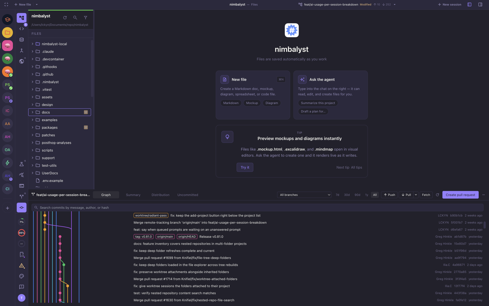
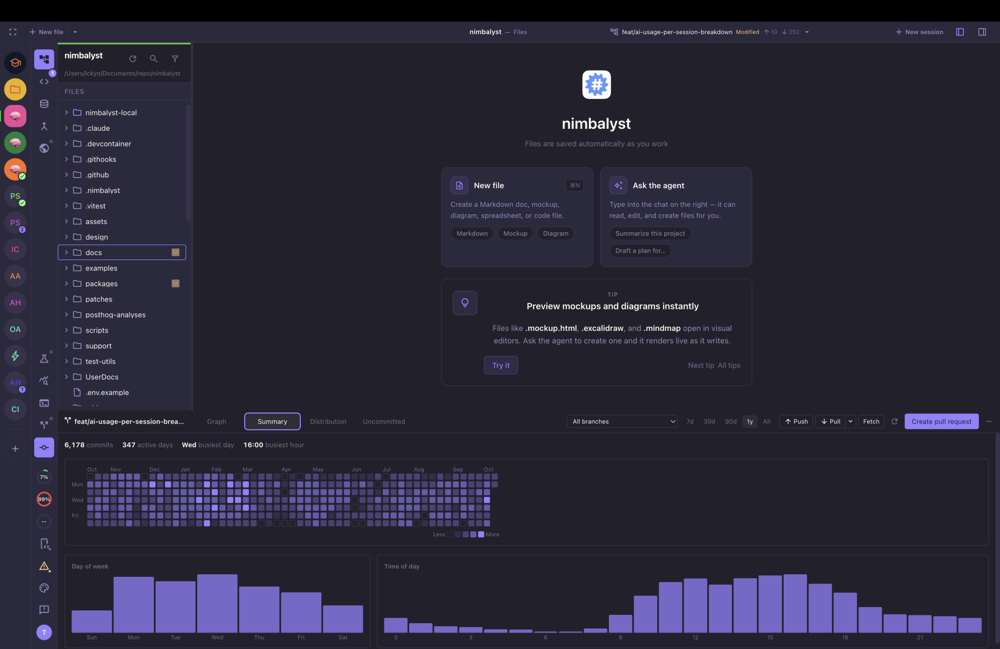
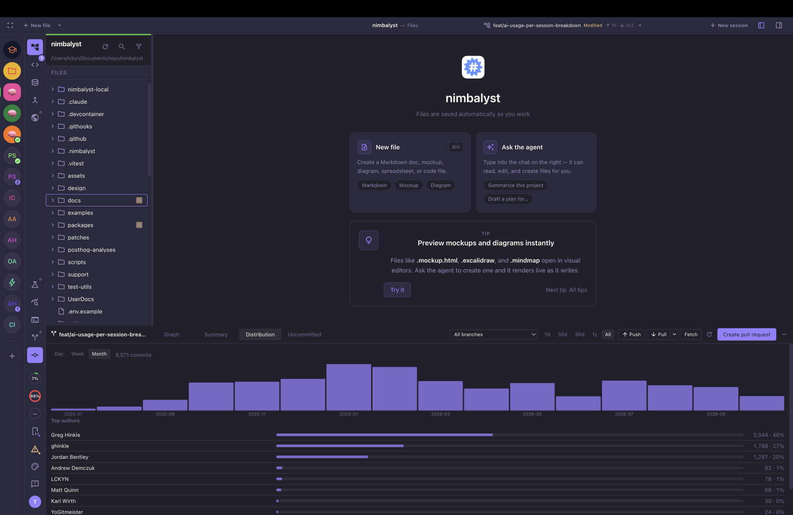
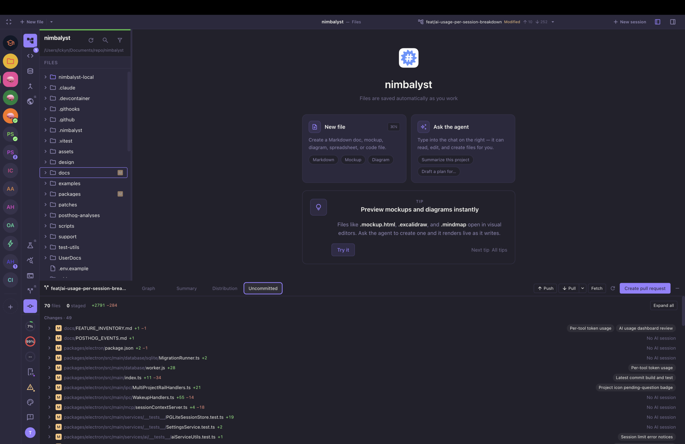

# Git Insights for Nimbalyst

A bottom-panel extension for [Nimbalyst](https://nimbalyst.com) that shows your repository's history at a glance: a commit graph, activity heatmap, commit distribution, and which AI session touched each uncommitted file. It also handles push, pull, fetch, and one-click pull/merge requests.

## Features

### Graph

Branch lanes with ref badges (branches, tags, worktrees), a commit detail pane, and context-menu actions. Search by message, author, or hash prefix. Filter by branch and time range (7d / 30d / 90d / 1y / All).



### Summary

Total commits, active days, busiest day and hour, a GitHub-style heatmap, and day-of-week / time-of-day charts.



### Distribution

Commits per day, week, or month (quiet periods included), plus top authors by share.



### Uncommitted

Every changed file with its status, staged state, line counts, and inline diff, tagged with the Nimbalyst AI session that edited it (or "No AI session").



### Sync and pull requests

- **Push** (publishes to `origin` when the branch has no upstream), **Pull** with a remembered rebase / merge / ff-only strategy, and **Fetch** with `--prune`.
- **Create pull request** pushes the branch, reuses an existing PR if there is one, and refuses the default branch or a detached HEAD. Uses `gh` for GitHub and `glab` for GitLab; the button is disabled with a reason when the CLI is missing or logged out.
- All tabs refresh on git status changes.

## Requirements

- Nimbalyst with **Extension Dev Tools** enabled (Settings → Advanced)
- Node.js 18+
- `git`, plus `gh` and/or `glab` for pull/merge requests

## Install

```bash
npm install
npm run build
```

Then ask the Nimbalyst agent to install it:

> Build and install the extension from /path/to/nimbalyst-git-insights

The panel's backend (which runs `git`, `gh`, and `glab`) is disabled by default; Nimbalyst asks you to enable it the first time you open the panel.

## Development

```bash
npm run dev        # rebuild on change
npm test           # vitest
npm run typecheck
```
